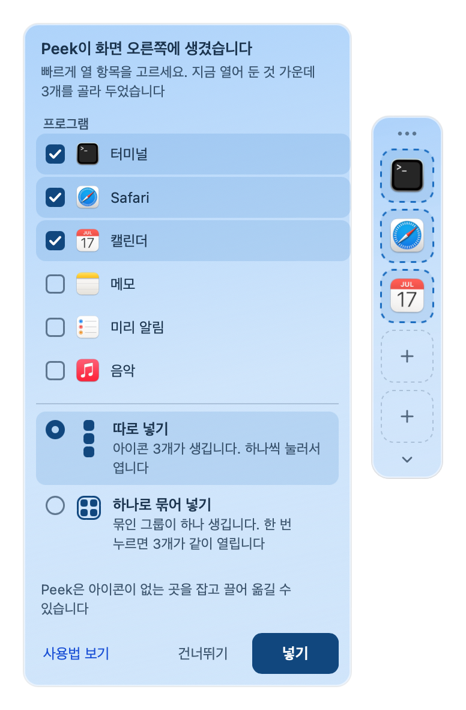
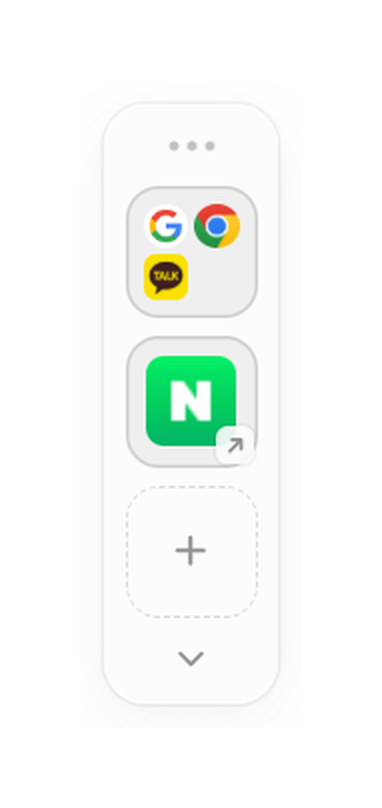
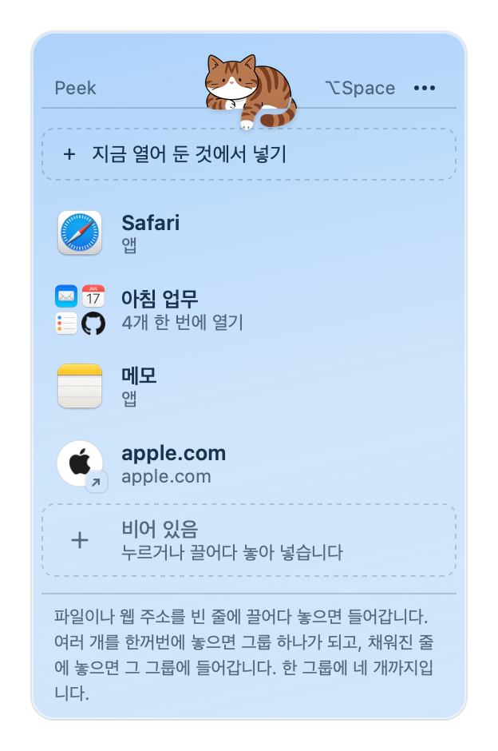
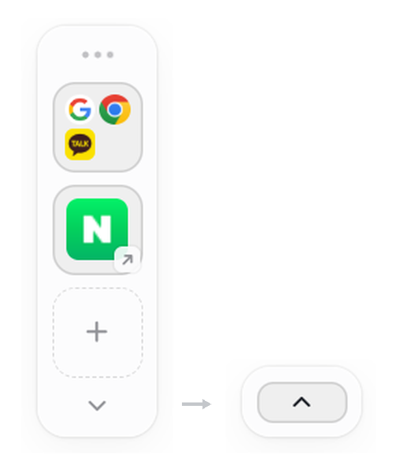
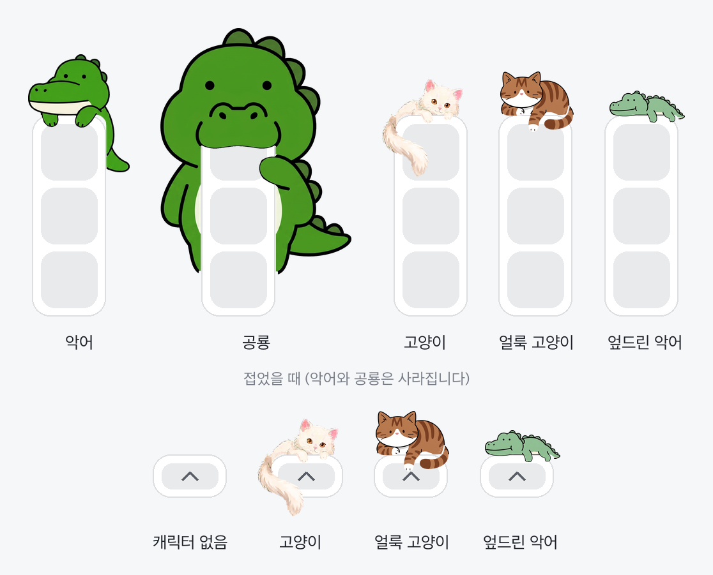

# Peek

윈도우와 맥에서 쓰는 바탕화면 런처 위젯입니다. 화면 가장자리에 아이콘을 최대 5개까지 두고 웹페이지, 프로그램, 파일, 폴더를 한곳에서 엽니다. 맥에서는 메뉴 막대에 둘 수도 있습니다.
A desktop launcher and dock for Windows and macOS. Up to five icons at the edge of your screen open web pages, programs, files and folders from one place. On a Mac, Peek can also sit under the menu bar.

[한국어](#한국어) · [English](#english)

이 저장소에는 설치 파일만 있습니다. 소스 코드는 공개하지 않습니다.
This repository holds installers only. The source code is not public.

---

## 한국어

매일 사용하는 프로그램과 웹페이지가 즐겨찾기, 바탕화면 바로가기, 탐색기에 흩어져 있으면 찾는 데 시간이 걸립니다. Peek은 이것들을 화면 가장자리의 작은 위젯에 모아 둡니다. 바탕화면에 바로가기 아이콘을 늘어놓지 않아도 됩니다.

### 처음 켜면



Peek을 처음 실행하면 화면 오른쪽 가장자리에 위젯이 나타나고, 옆에 실행 중인 프로그램과 열린 폴더, 브라우저 창별 현재 탭의 목록이 표시됩니다. 이 중 3개가 미리 선택되어 위젯에 미리보기로 보이며, 넣기를 클릭해야 실제로 추가됩니다. 항목마다 아이콘을 따로 만들려면 "따로 넣기"를, 한 번에 함께 열리는 그룹으로 만들려면 "하나로 묶어 넣기"를 선택합니다.

이 목록은 나중에 점 세 개 메뉴의 "지금 열어 둔 것에서 넣기"로 다시 열 수 있습니다.

### 여러 개를 한 번에 열기



자주 함께 사용하는 항목은 그룹 하나로 묶을 수 있습니다. 오른쪽 그림에서는 맨 위 그룹에 Gmail, Chrome, 메신저가 함께 들어 있습니다.

1. **그룹으로 묶습니다.** 아이콘을 다른 아이콘의 가운데로 끌어다 놓으면 두 항목이 하나의 그룹으로 묶입니다. 한 그룹에 최대 4개까지 넣을 수 있습니다.
2. **한 번 클릭하면 모두 실행됩니다.** 그룹을 클릭하면 안에 있는 항목이 전부 열립니다.
3. **단축키를 지정할 수 있습니다.** 그룹을 마우스 오른쪽 버튼으로 클릭한 뒤 단축키 걸기를 선택하고 원하는 글자를 누릅니다. Ctrl + Alt가 자동으로 붙습니다.

두 번째 아이콘은 웹 주소입니다. 웹 주소를 넣으면 해당 사이트의 아이콘이 자동으로 표시됩니다.

<br clear="right">

### 맥에서는 메뉴 막대에



맥에서는 위젯을 화면 가장자리에 띄우는 대신 메뉴 막대에 둘 수 있습니다. 처음 설치하면 이 방식으로 시작하며, 점 세 개 메뉴 맨 위의 "보이는 곳"에서 가장자리와 메뉴 막대 중 하나를 선택합니다.

- ⌥Space로 열고, 바깥을 클릭하면 닫힙니다.
- 파일을 메뉴 막대의 Peek 위로 끌어다 잠시 기다리면 목록이 열립니다. 여러 파일을 한 번에 놓으면 그룹이 됩니다.
- 항목 끝의 점 세 개 메뉴에서 "단축어에 연결"을 선택하면 단축어 앱의 자동화로 해당 항목을 열 수 있습니다.

Safari 탭과 Finder 폴더를 목록에 표시하기 위해 처음에 자동화 권한을 요청합니다. 허용하지 않아도 나머지 기능은 그대로 사용할 수 있습니다.

<br clear="right">

### 다운로드

[Releases](../../releases) 에서 최신 버전을 받을 수 있습니다.

| 운영체제 | 파일 | 요구 사항 |
|---|---|---|
| 윈도우 | `Peek_x.y.z_x64-setup.exe` | 윈도우 10 이상, 64비트 |
| 맥 | `Peek_x.y.z_universal.dmg` | 애플 실리콘과 인텔 모두 |

### 설치

**윈도우.** 설치 파일을 실행하면 "게시자를 알 수 없습니다"라는 경고가 표시됩니다. 코드 서명을 하지 않은 개인 제작 프로그램이기 때문입니다. 추가 정보를 클릭한 뒤 실행을 선택하면 설치가 진행됩니다.

**맥.** dmg 파일을 열어 Peek을 응용 프로그램 폴더로 옮깁니다. 그다음 아이콘을 마우스 오른쪽 버튼으로 클릭하고 열기를 선택합니다. 서명과 공증을 거치지 않아 더블클릭으로는 실행되지 않습니다. 그래도 실행되지 않으면 터미널에서 `xattr -cr /Applications/Peek.app` 명령을 한 번 실행합니다.

새 버전을 덮어 설치해도 넣어 둔 아이콘은 그대로 유지됩니다. 사용법은 점 세 개 메뉴나 트레이 아이콘에서 엽니다.

### 넣기와 정리하기

**넣기.** 웹페이지, 프로그램, 폴더를 위젯의 + 위로 끌어다 놓으면 추가됩니다. 브라우저 주소창의 링크를 끌어와도 됩니다. + 를 클릭해 주소나 경로를 직접 입력할 수도 있습니다.

**접기.** 아래쪽 화살표를 클릭하면 위젯이 접힙니다. 너비는 그대로 두고 아래쪽 한 줄만 보입니다. 평소에 열고 닫는 방법입니다.



**한꺼번에 감추기.** 윈도우에서는 Windows 키 + D를 누르면 다른 창과 함께 접히고, 다시 누르면 함께 돌아옵니다. 화면을 공유할 때 위젯만 따로 치울 필요가 없습니다.

**옮기기와 순서 바꾸기.** 아이콘이 없는 빈 곳을 잡고 끌면 위젯이 이동하고, 화면 가장자리에 자동으로 붙습니다. 접혀 있을 때는 캐릭터를 잡고 끌어도 됩니다. 아이콘을 끌어 다른 아이콘의 위나 아래에 놓으면 순서가 바뀝니다.

### 그 밖의 기능

| 조작 | 기능 |
|---|---|
| 아이콘을 오른쪽 버튼으로 클릭 | 이름과 주소 수정 |
| 아이콘 위에 마우스 올리기 | 빨간색 X 버튼으로 삭제 |
| 점 세 개 클릭, 또는 위젯을 오른쪽 버튼으로 클릭 | 보이는 곳(맥), 테마, 색, 언어, 캐릭터, 자동 실행, 지금 열어 둔 것에서 넣기, 사용법 |
| 트레이 아이콘 | 윈도우: 위젯 맨 앞으로, 화면 중앙으로, 사용법, 종료<br>맥: 위젯 맨 앞으로, 화면 중앙으로, 설정, 사용법, 종료. 메뉴 막대 방식에서는 설정, 사용법, 종료 |

색은 기본, 핑크, 파랑, 초록, 보라, 모래 6가지이며 라이트 모드와 다크 모드에 맞는 색이 각각 적용됩니다. 언어는 한국어와 영어를 지원하며, 기본값은 운영체제 언어를 따릅니다.

"항상 위"로 설정된 다른 창에 위젯이 가려졌을 때는 마우스를 위젯 위치로 가져가면 맨 앞으로 올라옵니다. 위젯이 보이지 않을 때는 트레이 아이콘에서 "화면 중앙으로"를 선택합니다.

다른 프로그램에서 Peek을 호출할 때는 아래 주소를 사용합니다. Peek이 실행 중이 아니면 자동으로 실행되며, 이름은 아이콘이나 그룹의 이름과 정확히 일치해야 합니다.

```
peek://open/<아이콘 또는 그룹의 이름>
```

### 캐릭터

부가 기능입니다. 다섯 개의 캐릭터 중 하나를 위젯 위에 표시할 수 있으며, 캐릭터는 이따금 움직입니다. 기본값은 캐릭터를 표시하지 않는 것입니다. 위젯을 접으면 악어와 공룡은 함께 사라지고, 고양이, 얼룩 고양이, 엎드린 악어는 그대로 보입니다.



### 개인 정보

넣어 둔 주소와 사용 기록은 사용자의 컴퓨터 밖으로 전송되지 않습니다. 계정도 서버 동기화도 없습니다. "지금 열어 둔 것에서 넣기"의 목록도 컴퓨터 안에서만 처리합니다. 외부와 통신하는 경우는 웹 주소의 아이콘을 가져올 때와 새 버전을 확인할 때 두 가지이며, 두 경우 모두 사용자 정보는 보내지 않습니다.

설정은 아래 파일 한 개에만 저장됩니다.

```
윈도우  %APPDATA%\app.peekwidget\config.json
맥      ~/Library/Application Support/app.peekwidget/config.json
```

이 파일에는 넣어 둔 아이콘과 위젯 위치, 테마와 색, 언어, 캐릭터, 자동 실행 여부, 아이콘별 실행 횟수와 위젯을 접은 날짜가 들어 있습니다. 다른 컴퓨터로 옮기려면 같은 경로에 이 파일을 복사합니다. 웹 주소는 그대로 열리지만 프로그램과 폴더는 경로가 같아야 열립니다.

### 삭제

윈도우에서는 설정 > 앱 > 설치된 앱에서 Peek을 제거합니다. 맥에서는 응용 프로그램 폴더에서 Peek.app을 삭제합니다. 설정 파일은 위 경로에 그대로 있으므로 필요하면 해당 폴더도 함께 삭제합니다.

### 문의

버그나 불편한 점은 [Issues](../../issues) 에 올려 주세요. 개인이 만든 프로그램이라 답변이 늦을 수 있습니다.

---

## English

The programs and web pages you use every day are spread across bookmarks, desktop shortcuts and the file explorer. Finding them takes time. Peek collects them into a small widget at the edge of your screen. It works like a small dock or desktop organizer, but a single icon can hold a website, an app and a folder together and open them all with one click.

### First start


On first launch, the widget appears on the right edge of your screen next to a list of running programs, open folders and the current tab of each browser window. Three items are preselected and previewed in the widget, but nothing is added until you click Add. Choose "Add separately" to get one icon per item, or "Add as one group" to open them all with one click.

You can reopen this list later from "Add from what is open now" in the three-dot menu.

### Opening several items at once


Items you always use together can be combined into a group. In the picture on the right, the top group holds Gmail, Chrome and a messenger.

1. **Make a group.** Drag an icon onto the center of another icon to combine the two. A group holds up to four items.
2. **One click opens them all.** Clicking a group launches every item inside it.
3. **Assign a shortcut.** Right-click the group, choose Set a shortcut and press a key. Ctrl + Alt is added automatically.

The second icon is a web address. When you add a web address, the site's own icon is displayed automatically.

<br clear="right">

### On a Mac, in the menu bar


On a Mac, Peek can live in the menu bar instead of floating at the edge of the screen. A new install starts this way. Switch between the two under "Show in" at the top of the three-dot menu.

- Press ⌥Space to open it. Click anywhere else to close it.
- Drag a file onto Peek in the menu bar and hold for a moment to open the list. Drop several files at once to make a group.
- Choose "Connect to Shortcuts" from the three-dot menu at the end of a row to open it from a Shortcuts automation.

Peek asks for Automation permission on first launch to list Safari tabs and Finder folders. Everything else works if you decline.

<br clear="right">

### Download

The latest version is available on the [Releases](../../releases) page.

| System | File | Requirements |
|---|---|---|
| Windows | `Peek_x.y.z_x64-setup.exe` | Windows 10 or later, 64-bit |
| macOS | `Peek_x.y.z_universal.dmg` | Apple silicon and Intel |

### Installation

**Windows.** The installer displays an "unknown publisher" warning because the program is not code signed. Click More info and then Run to continue.

**macOS.** Open the dmg file and move Peek to the Applications folder. Then right-click the icon and choose Open. Double-clicking will not work, because the app is neither signed nor notarized. If it still refuses to open, run `xattr -cr /Applications/Peek.app` once in Terminal.

Installing a newer version over an older one keeps the icons you have already added. The how-to window opens from the three-dot menu or the tray icon.

### Adding and tidying

**Adding.** Drag web pages, programs and folders onto the + in the widget to add them. Links dragged from a browser address bar also work. You can also click the + and type an address or a path.

**Folding.** Clicking the arrow at the bottom folds the widget. The width stays the same and only the bottom row is shown. This is the everyday way to open and close it.


**Hiding it with everything else.** On Windows, pressing the Windows key and D folds Peek together with your other windows, and pressing it again brings them all back. When you share your screen, you do not have to put the widget away separately.

**Moving and reordering.** Drag any spot without an icon to move the widget, which then snaps to the edge of the screen. When the widget is folded, you can also drag the character. Drag an icon above or below another icon to change the order.

### Other features

| Action | Function |
|---|---|
| Right-click an icon | Edit its name and address |
| Hover over an icon | Delete with the red X button |
| Click the three dots, or right-click the widget | Show in (macOS), theme, color, language, character, start-up, add from what is open now, how to use |
| Tray icon | Windows: bring widget to front, move to center, how to use, quit<br>macOS: bring widget to front, move to center, settings, how to use, quit. In the menu bar layout: settings, how to use, quit |

There are six colors: default, pink, blue, green, violet and sand, each with light and dark mode variants. Korean and English are supported, and Peek follows your system language by default.

If another "always on top" window covers the widget, move the mouse over the widget's position to bring it to the front. If you cannot find the widget, choose "Move to center" from the tray icon.

Other programs can call Peek using the address below. Peek starts automatically if it is not running, and the name must match exactly.

```
peek://open/<name of the icon or group>
```

### Characters

An optional feature. One of five characters can be displayed on the widget, and the character moves from time to time. By default no character is shown. When the widget is folded, the crocodile and the dinosaur disappear with it, while the cat, the tabby and the resting crocodile stay visible.


### Privacy

The addresses you add and your usage history are never sent outside your computer. There is no account and no server synchronization. The "Add from what is open now" list is also processed only on your computer. Peek connects to the network in two cases: to fetch the icon for a web address, and to check whether a newer version exists. Neither request sends any data about you.

Settings are stored in a single file.

```
Windows  %APPDATA%\app.peekwidget\config.json
macOS    ~/Library/Application Support/app.peekwidget/config.json
```

This file holds the icons you added, the widget position, the theme and color, the language, the character, whether Peek starts at login, how many times each icon has been opened and the dates the widget was folded. To move your setup to another computer, copy this file to the same path. Web addresses open as before, but programs and folders only open if they sit at the same path on the new computer.

### Uninstalling

On Windows, remove Peek from Settings > Apps > Installed apps. On macOS, delete Peek.app from the Applications folder. The settings file stays at the path above, so delete that folder as well if required.

### Feedback

Please report bugs and problems on the [Issues](../../issues) page. Peek is made by one person, so replies may be slow.
